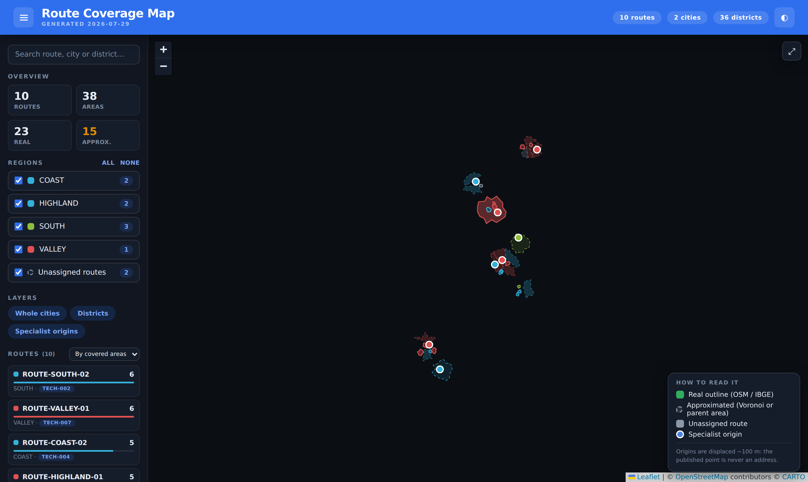
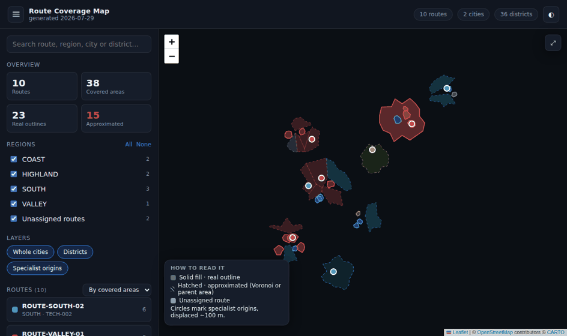

# Route Coverage Map

Geospatial route coverage pipeline: progressive geocoding, official IBGE
boundaries, Voronoi fallback, overlap clipping and a privacy-safe standalone
map that opens by double-click.

### ➜ [Open the live demo](https://jvfaraco.github.io/mapaderotas/)

Real pipeline, fictional data. Filter by region, search, click a route to zoom in.

[](https://jvfaraco.github.io/mapaderotas/)



> Both images come from `python -m route_coverage build --demo`, which uses an
> entirely fictional dataset. Basemap tiles are missing from the captures
> because they were recorded without network access.

## The problem

A field operation splits a territory into routes: each route covers some
districts, some whole municipalities, and is served by one specialist working
from a home base. The territory is described in spreadsheets — plain text
names, no coordinates — and the question people actually ask is spatial:
*where does this route end and the next one begin, and who covers what?*

Turning those spreadsheets into a map runs into four real problems:

1. **Address data is thin.** Outside big cities OpenStreetMap frequently has
   no house numbers, so a single geocoding query fails for a large share of
   the rows.
2. **District outlines often do not exist.** Many municipalities never
   formally delimited districts, so there is nothing to draw — not in OSM, not
   in the census files.
3. **Approximations overlap.** Once you approximate a missing outline, it
   spills into the neighbour's real one. Semi-transparent fills turn every
   overlap into a muddled colour, and the map stops being readable.
4. **The data is personal.** Home addresses of real people cannot end up in a
   file that gets forwarded around.

## What this does

A four-stage pipeline turns two tabular files into one self-contained HTML
map, with every approximation labelled as such:

```
routes.csv ┐                                        ┌ standalone HTML
           ├─→ geocode ─→ cache ─→ build ─→ payload ┤  (opens from disk,
specialists┘   (OSM+IBGE) (JSON)   (clip)  (allowlist) no server, no build)
```

Numbers from the demo dataset (`dist/stats.json`, produced by every build):

| Metric | Demo run |
| --- | --- |
| Covered areas rendered | 39 (2 whole cities, 37 districts) |
| Real outlines vs approximations | 21 vs 16 |
| Overlaps clipped | 6 polygons cut, 1 fully covered and dropped |
| Cache reuse on a second run | 100% (no provider call repeated) |
| Standalone map size | 0.21 MB, Leaflet included |
| Build time (demo, cold) | ~0.2 s |
| Test coverage | 83% |

### Technical highlights

- **Progressive geocoding.** `address → street → district → district within
  the city's bounding box → city`. Each level records how exact it was in
  `location_precision`, which the map legend shows instead of pretending
  everything is equally precise.
- **Three sources for district outlines, in cascade.** OpenStreetMap →
  OpenStreetMap with safe name variants (`Jd Sta Genebra II (Barao Geraldo)` →
  `Jd Sta Genebra`) → IBGE 2022 census districts, matched exactly, then by
  variant, then fuzzily above 0.88 similarity.
- **Voronoi fallback with a guarantee.** Whatever the cascade could not
  resolve gets the area closer to its point than to any other district point
  of the same city, clipped to the municipal boundary. Every district ends up
  with an area; none of them pretends to be official.
- **Overlap clipping.** Polygons are ranked (real outline beats approximation;
  on a tie the smaller one stays whole) and cut against each other, so no two
  specialists share a pixel. A regression test asserts the residual
  intersection is zero.
- **A cache that is actually a cache.** Geometry is fetched once; route
  ownership is refreshed from the spreadsheet on every run. Writes are atomic
  with a rolling `.bak`, so an interrupted run never costs a re-geocode.
- **No network at build time.** Leaflet is vendored and checksum-verified; the
  demo runs the whole pipeline against deterministic synthetic providers.

## Architecture

```
src/route_coverage/
├── cli.py             # geocode · dedupe · build · demo
├── config.py          # settings from the environment (.env.example)
├── models.py          # Specialist, RouteArea, GeocodeResult, CoverageStats
├── normalization.py   # place names, state codes, safe name variants
├── privacy.py         # jitter, allowlists, the "is this safe?" assertion
├── cache.py           # atomic persistence, metadata refresh, dedupe
├── pipeline.py        # orchestration, provider-agnostic
├── inputs/            # csv/xlsx adapters with loose header matching
├── geocoding/         # nominatim · ibge · cascade · synthetic (offline)
├── geometry/          # neighborhoods · voronoi · overlaps · shapes
└── rendering/         # payload (allowlist) · standalone (bundling)
web/                   # index.html · styles.css · map.js · vendored Leaflet
data/                  # input examples · demo dataset · private (git-ignored)
```

The pipeline depends on two narrow ports — `GeocodingProvider` and
`BoundaryProvider` — never on HTTP. That is what lets the demo and the whole
test suite run offline against synthetic implementations of the same
interfaces. See [`docs/architecture.md`](docs/architecture.md) for the
reasoning behind each decision.

## Privacy by design

Privacy is a property of the payload, not of the interface — hiding a name on
screen while shipping it in the embedded JSON hides nothing.

- **Technical identifiers only.** Sources are joined by `specialist_id`
  (`TECH-001`) and `route_id` (`ROUTE-SOUTH-01`). No name exists anywhere in
  the pipeline.
- **Street and number never reach the cache.** They are read to geocode and
  dropped as soon as a coordinate exists.
- **Address-level coordinates are jittered.** A deterministic 60–120 m
  displacement (stable across rebuilds), relabelled `block` so the map does
  not claim a precision the jitter removed.
- **An explicit allowlist.** Only known-safe fields are serialised; the
  payload is then asserted free of forbidden keys, e-mail addresses and
  street-address shapes, and the build fails if anything slips through.

A safe record, in full:

```json
{
  "specialist_id": "TECH-001",
  "route_id": "ROUTE-SOUTH-01",
  "region": "SOUTH",
  "latitude": -27.60,
  "longitude": -48.55,
  "location_precision": "district"
}
```

## Quick start

```bash
python -m venv .venv && source .venv/bin/activate
pip install -e ".[dev]"

# Fictional dataset, no network, one command:
python -m route_coverage build --demo --out dist/route-coverage-map.html
```

Open `dist/route-coverage-map.html` by double-clicking it. Only the basemap
tiles come from the internet. The same build is published on every push to
`main` at **<https://jvfaraco.github.io/mapaderotas/>**.

With your own data:

```bash
cp .env.example .env                       # set a contact e-mail for Nominatim
python -m route_coverage geocode \
    --routes data/private/routes.csv \
    --specialists data/private/specialists.csv \
    --report data/private/report.csv       # per-district audit trail
python -m route_coverage dedupe            # merge entries that differ by casing
python -m route_coverage build --out dist/map.html
```

`data/private/` is git-ignored; nothing you put there can be committed.

## Data format

`routes.csv` — one row per covered area. An empty `district` means the route
covers the whole municipality; an empty `specialist_id` marks an unassigned
route. Header names are matched loosely (`Município`, `Bairro`, `UF` and other
common variants work), and `.xlsx` is accepted too.

```csv
route_id,specialist_id,region,state,city,district
ROUTE-SOUTH-01,TECH-001,SOUTH,SC,Porto Aurora,Centro Historico
ROUTE-SOUTH-03,TECH-008,SOUTH,SC,Nova Bracara,
ROUTE-DISTANT-01,,VALLEY,SP,Serra Do Eco,Colonia Antiga
```

`specialists.csv` — one row per specialist. `street`/`number` are optional and
never published; `latitude`/`longitude` are an optional manual override that
skips the geocoder entirely.

```csv
specialist_id,region,street,number,district,city,state,latitude,longitude
TECH-001,SOUTH,Rua das Bromelias,120,Centro Historico,Porto Aurora,SC,,
TECH-008,SOUTH,,,Centro,Nova Bracara,SC,-27.8801,-46.0502
```

Full examples in [`data/input/`](data/input); the complete fictional dataset
in [`data/demo/`](data/demo).

## Tests

```bash
pytest --cov=route_coverage --cov-report=term-missing
```

The suite runs with no network access and no real data: providers are mocked
or synthetic, fixtures are fictional. It covers normalization and cache keys,
input parsing (including the `Sum` row real exports carry), cache atomicity
and deduplication, the geocoding cascade, Voronoi filling, overlap clipping,
the privacy allowlist, and an end-to-end demo build asserted to be
self-contained, deterministic, overlap-free and free of personal data.

CI runs lint, types, tests with an 80% coverage floor, the demo build, an
output check and a personal-data scan on Python 3.11 and 3.12.

## Limitations

- Coverage of official district outlines is partial by nature: only
  municipalities that formally delimited districts with IBGE are published, so
  entire states (or big cities such as Campinas) fall back to Voronoi.
- Voronoi cells are an area of influence, not a legal boundary. They are drawn
  hatched and labelled as approximations for that reason.
- Nominatim's usage policy caps anonymous clients at ~1 request/second, so the
  first run over a large territory takes a while. Everything after that is
  served from the cache.
- Basemap tiles still come from the network; only the data and the library are
  embedded.
- Fuzzy district matching above 0.88 similarity can pick the wrong homonym.
  The audit report (`--report`) lists the method, matched name, score and near
  misses for exactly this reason.

## Technical decisions

| Decision | Why |
| --- | --- |
| Cache keyed by canonical names | `CAMPINAS` and `Campinas` were becoming two entries with two overlapping polygons. |
| Clipping at render time, not in the cache | The cache stays a faithful record of what the sources returned; presentation choices stay reversible. |
| Vendored Leaflet with checksums | No CDN at build time, and the exact bytes shipped in every map are auditable. |
| Ports for providers | Offline demo and offline tests, without mocking HTTP. |
| Allowlist instead of denylist | A field added upstream is dropped by default rather than leaked by default. |
| Single HTML output | The audience has no Python and no server; a double-click has to be enough. |

## License

[MIT](LICENSE). Leaflet is bundled under its own
[BSD-2-Clause license](web/vendor/leaflet/LICENSE).
